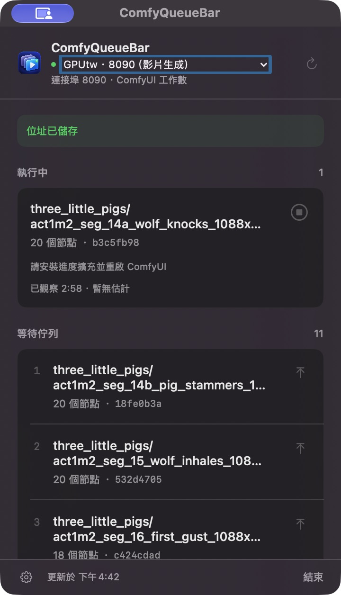
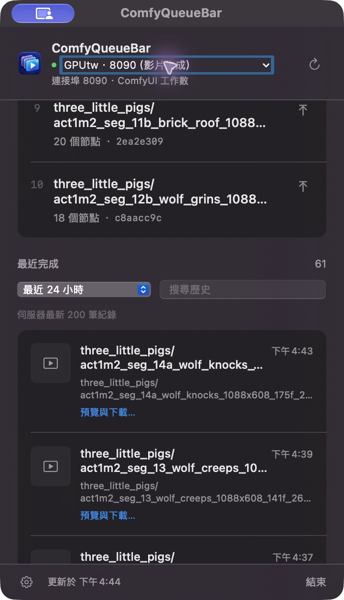

# 用 ComfyQueueBar 查看 GPUtw.ai 的影片佇列

一次把多支影片排進 ComfyUI 後，可以用 **ComfyQueueBar** 在 Mac 選單列查看還有多少工作正在執行、多少工作等待處理，不必一直切回 ComfyUI 網頁。

本篇帶你將 ComfyQueueBar 連到 **GPUtw.ai 上正在使用的 ComfyUI**。所有已儲存服務可同時監控；多台時選單列顯示「空閒台數／總台數」，每台卡片分別顯示「執行中＋等待中」的工作數，一個工作可能輸出一支或多支影片。

[回到專案首頁](README.zh-TW.md) · [完整遠端設定與疑難排解](REMOTE_SETUP.zh-TW.md)

## 先看實際畫面



這是 **2026-10-05 的真實工作畫面**：當時連到 `8090`，**1 個工作執行中、11 個等待中，合計 12 個尚未結束的工作**。數字會隨生成進度改變；11 個等待工作並非同時運算。

圖中的「請安裝進度擴充並重啟 ComfyUI」只影響節點百分比，**不影響佇列數量監控**。可以先使用佇列功能，等目前影片生成結束後再處理擴充。

## 1. 準備支援 GPUtw 的版本

**從 v1.5.3 起，下載版已包含 GPUtw 內建登入。** 若目前使用 v1.5.2，請在 App 的齒輪設定按 **檢查更新…**；也可從 [GitHub Releases](https://github.com/sakmor/ComfyQueueBar/releases/latest) 下載新版。下載版需要 macOS 13 以上與 Apple Silicon（M1 或更新）。

若使用 Intel Mac 或想自行編譯，還需要 Swift 5.9 以上的 Xcode／Command Line Tools。若尚未安裝編譯工具，先執行 `xcode-select --install`，完成後再執行：

```sh
git clone https://github.com/sakmor/ComfyQueueBar.git
cd ComfyQueueBar
bash build-app.sh
open build/ComfyQueueBar.app
```

若已開啟舊版 ComfyQueueBar，請先從舊版面板按 **結束**，再開啟剛編譯的版本，以免出現兩個選單列圖示。結束 ComfyQueueBar 不會停止遠端 ComfyUI 的生成工作。

詳細環境與安裝說明見[原始碼編譯教學](../../README.md#build-from-source)。

## 2. 在 App 內登入 GPUtw.ai

1. 確認 GPUtw 執行個體正在運行，且 ComfyUI 已啟動。
2. 點 macOS 選單列的 **ComfyQueueBar 圖示**，再點面板左下角的 **齒輪**。
3. 按 **登入 GPUtw…**，App 會直接開啟 GPUtw 控制台，不會沿用已儲存的舊服務位址。也可在 **ComfyUI 位址** 填入 `https://gputw.ai/dashboard`，再按 **連線**。
4. 在 App 開啟的瀏覽器完成 GPUtw 登入。Chrome 或 Safari 的登入狀態不會自動共用到 App。
5. 從 GPUtw 控制台開啟這次生成影片所用的 **ComfyUI Web UI**。若使用自訂 HTTP 連接埠，請開啟對應連接埠的 Web UI；有密碼保護時，在 GPUtw 頁面輸入既有密碼。

若舊連線回傳 404，執行個體可能已停止或更換，也可能是 HTTP 連接埠無法使用；404 本身不能確定是登入失敗。可按 **選擇運行中的 GPUtw** 回到控制台。針對舊連接埠的恢復檢查若回傳 404 或要求登入，App 也會帶你回到控制台，提示重新選擇。更換執行個體後，請選擇目前運行中的機器，再開啟它的 ComfyUI；舊位址不會自動對應到新機器。一般登入不需要 API 金鑰，金鑰設定收在 **進階：使用 API 金鑰啟用 HTTP 連接埠**。

只停留在控制台或 Jupyter 頁面還不算選定 ComfyUI。必須先進入實際的 ComfyUI 服務，下一步的 **確認此 ComfyUI** 才能使用。

## 3. 核對連接埠，再開始監控

1. 在 App 內瀏覽器上方按 **確認此 ComfyUI**。
2. 在確認視窗核對 **連接埠、執行中／等待中數量，以及最近成功的工作**，確認和你提交影片的服務相符。
3. 按 **監控此伺服器**，App 才會儲存並選用這個服務。按 **取消** 會保留原本的監控連線。
4. 在齒輪設定中，可將 **伺服器名稱** 設成容易辨識的名稱，例如 `GPUtw · 8090（影片生成）`，再按 **儲存位址**。

**最容易選錯的是連接埠。** GPUtw 的 Web UI 網址形式為 `https://<連接埠>-<執行個體 ID>.gputw.ai`；同一個 GPU 執行個體可能有不同的 ComfyUI 服務。

| 你的生成頁面 | App 應核對的連接埠 |
| --- | --- |
| `https://8080-<執行個體 ID>.gputw.ai` | `8080` |
| `https://8090-<執行個體 ID>.gputw.ai` | `8090` |

`8080`、`8090` 是本篇的說明範例，**請以自己提交工作的頁面網址為準**。如果影片在 `8090` 排隊，連到另一個空的 `8080` 佇列，看到的數字就可能是 0。

現在若在確認視窗檢查到 `8080` 或 `8090` 的佇列為空，App 會順便讀取同一執行個體的另一個常用連接埠。若找到工作，可按 **查看連接埠** 再確認並切換；若服務需要登入，可按 **連接** 開啟自動設定功能，或在 App 的 GPUtw 瀏覽器完成登入。App 不會未經確認就更換監控服務，也不會掃描其他所有連接埠。

### 直接啟用並連接 8090（新版原始碼）

也可在「設定 → 連線」展開 **GPUtw 8090 SSH 連線**，輸入控制台顯示的完整執行個體 ID，按 **連線並記住**。App 使用這台 Mac 既有的 SSH 金鑰和 `known_hosts`，透過僅供本機使用的 `127.0.0.1:18774` 連到該執行個體的 8090。App 啟動後會恢復這條通道，斷線時每 30 秒重試；執行個體更換時需輸入新的 ID。此方式不需要 GPUtw API 金鑰，也不會更改 GPUtw HTTP 連接埠設定。

請先讓該 Mac 的 SSH 金鑰可免互動登入 GPUtw，並確認主機金鑰已存在 `known_hosts`；App 不會代為接受新的主機金鑰或輸入密碼。執行個體與 8090 ComfyUI 須已運行。若 18774 被其他程式佔用，App 不會將該服務當成 GPUtw；請釋放該連接埠。按 **停用 SSH 連線**可移除記住的 ID 並關閉通道。App 結束時通道會關閉，依賴它的背景任務將無法連線，直到 App 再次啟動並連上。

在 **ComfyUI 位址** 貼上同一執行個體的 GPUtw 服務網址（例如 `8080` 或 `8090`），按 **連接 8090…**。也可在內建 GPUtw 瀏覽器開啟該執行個體的服務後，按 **連接 8090…**。

在 App 的金鑰欄位輸入具有 **instances:read** 與 **ports:manage** 權限的 GPUtw API 金鑰，按 **啟用並連接 8090**。App 會讀取該執行個體；若 8090 尚未啟用，就保留其他 HTTP 連接埠及存取模式、補上私人模式的 8090，接著取得短效登入連結，在內建瀏覽器完成登入交接。取得有效的 ComfyUI 佇列後，App 會自動儲存並選取這台服務、開始監控。已啟用的 8090 不會重新改寫設定。金鑰只供本次操作，不會儲存；額外連接埠可能產生 GPUtw 費用。

執行個體與 8090 上的 ComfyUI 必須已啟動；此功能不會重新部署或重啟容器。若有密碼頁，請在內建瀏覽器完成驗證。連接埠剛啟用時，App 會短暫重試；仍未連上可按 **重試連線**。不用 API 金鑰時，也可展開 **不用 API 金鑰，手動連線**，透過控制台設定及登入。

**404 本身不能確定原因。** 自動設定功能會以執行個體的實際設定判斷是否需要新增 8090，再驗證該位址的 ComfyUI 佇列；不會只憑 404 就更動連接埠。參考 [GPUtw API 權限](https://docs.gputw.ai/zh-TW/docs/api-keys)與[官方連接埠及登入交接契約](https://github.com/GPUtw-ai/GPUtw-Skill/blob/master/guides/05-ports-and-exposures.md)。


GPUtw 的私人服務由控制台建立擁有者登入狀態；密碼保護的服務會先驗證密碼。這個連線流程不需要平台 API 金鑰，也不需要把服務改成公開。參考官方 [Web UI 說明](https://docs.gputw.ai/zh-TW/docs/jupyter-web-ui)與[連接埠存取模式](https://docs.gputw.ai/zh-TW/docs/ports)。

## 4. 看還剩多少工作，以及哪些已完成

- **選單列數字**：目前服務的執行中＋等待中工作總數。
- **執行中**：目前正在處理的工作。
- **等待佇列**：排隊中的工作與順序。
- **最近完成**：已成功的工作，可依時間篩選、搜尋，並點 **預覽與下載…** 查看輸出。

佇列每 **4 秒**更新；歷史每 **15 秒**更新，讀取伺服器最新最多 **200 筆**紀錄。



這張圖是同一場實際生成稍後的畫面。第一張中的工作已進入 **最近完成**，在所選「最近 24 小時」範圍內顯示 61 筆。歷史數字受時間篩選與伺服器紀錄上限影響，不是帳號全部影片的累計數。

## 常見狀況

| 畫面或問題 | 如何處理 |
| --- | --- |
| 找不到「登入 GPUtw…」 | 確認 App 已更新到 v1.5.3 或更新版本；v1.5.2 沒有這個按鈕。 |
| GPU 正在忙，App 卻顯示 `0` | 核對生成頁面與 App 的連接埠，並查看近期工作。GPU 使用率與佇列數是不同資料。 |
| 顯示 `!` 或要求登入 | 在 App 內重新登入，開啟正確 ComfyUI Web UI，再確認監控。 |
| 顯示 `—` | 連線失敗或佇列資料過期，工作數目前未知，不能當成已完成。 |
| 顯示 `…` | 正在等待首次佇列回應。 |
| 有工作數，沒有節點百分比 | 佇列監控已可使用。百分比需在那台遠端 ComfyUI 安裝進度擴充，並等工作結束後重啟。 |

App 可同時監控所有已儲存服務，主機總覽會分別顯示各個連接埠的佇列狀態；不同連接埠可能指向同一套 ComfyUI，請自行確認，App 不會自動合併，也不顯示 GPU 使用率。若要切換，可點面板頂端的伺服器名稱，選擇已儲存的服務，再核對確認視窗。

遠端擴充、SSH 與登入恢復的完整步驟，請見[遠端設定教學](REMOTE_SETUP.zh-TW.md)。
